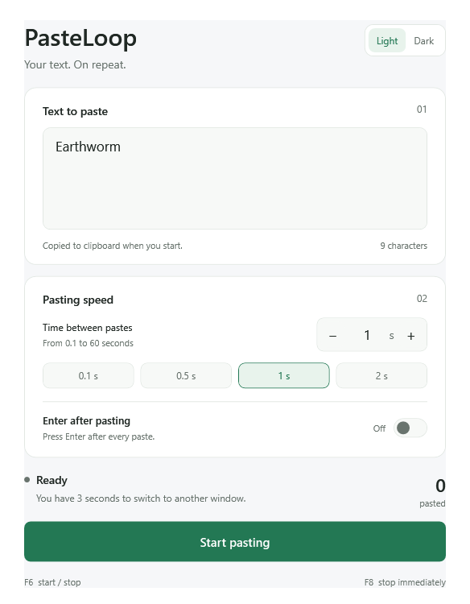
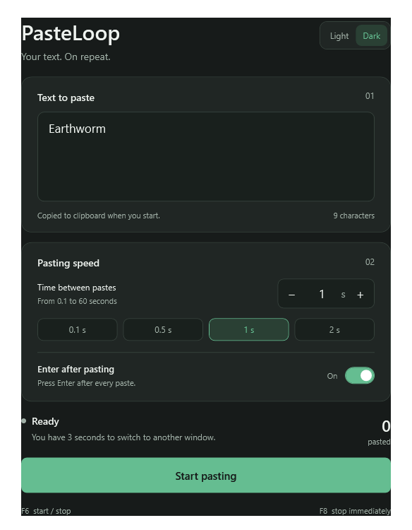

# PasteLoop

A simple Windows app that repeatedly pastes your text into the active window. Set a pace, choose a light or dark theme, and start with a keyboard shortcut.

PasteLoop is a portable WPF desktop app built with .NET Framework. It uses the Windows clipboard and sends **Ctrl+V** to the application you are using.

## Features

- Adjustable pause between pastes, from **0.1 to 60 seconds**.
- **F6** to start or stop; **F8** to stop immediately.
- A **3-second countdown** to switch to the destination window.
- Optional **Enter after each paste**, turned off by default.
- Light and dark themes, with your theme, interval and Enter preference remembered.
- Automatic stopping if the clipboard changes.

## Requirements

- Windows 10 or Windows 11.
- .NET Framework 4.8 enabled or installed.
- An application and text field that accept Ctrl+V.

PasteLoop runs without an installer. Windows may prevent it from sending input to an application running with higher privileges.

## Build

Open PowerShell in the project folder and run:

```powershell
.\build.ps1
```

The executable is created at `dist\PasteLoop.exe`. The build uses the .NET Framework compiler supplied with Windows; no .NET SDK or package download is required.

## Use

1. Open `dist\PasteLoop.exe` and enter the text to repeat.
2. Set the pause between pastes and choose a theme.
3. If wanted, enable **Enter after each paste**. In a chat or form, Enter may send the message or submit the form.
4. Click **Start pasting** or press **F6**.
5. During the countdown, switch to the destination application and click its text field.
6. Press **F8** to stop. **F6** also toggles pasting.

Pastes follow the active window. Returning to PasteLoop pauses output to its own window; switching to another application lets output continue. Input is also paused while modifier keys are held.

If another application already uses F8, PasteLoop disables starting so its emergency stop remains available. Close the conflicting application and reopen PasteLoop.

## Clipboard and saved settings

Starting copies your text to the Windows clipboard, replacing its previous contents. PasteLoop does **not** restore those contents when it stops. If the clipboard changes while running, pasting stops; start again to copy your chosen text back to the clipboard.

The text you enter is **not saved by PasteLoop**. Your theme, interval and Enter preference are saved locally. Windows clipboard history or other clipboard tools may retain copied text according to their own settings.

## Verification

Run the automated, noninteractive checks with:

```powershell
.\verify.ps1
```

These checks cover native input structure layout, interval validation, generated key sequences, toggle behavior, and both themes. They do not provide an end-to-end test of live keyboard input into another application. Actual paste behavior depends on the destination application, focus, and Windows permissions.

## Source layout

```text
src/
  PasteLoop.cs       Application logic and Windows input integration
  MainWindow.xaml   WPF interface
  app.manifest      Windows application manifest
build.ps1           Build the portable executable
verify.ps1          Run automated checks
```

## License

Licensed under the [MIT License](LICENSE).

## GitHub builds

The **Build Windows app** workflow builds and verifies the app on Windows after a push or pull request. Download the portable executable from the workflow run's **PasteLoop-Windows** artifact.

## Preview

| Light | Dark |
| --- | --- |
|  |  |